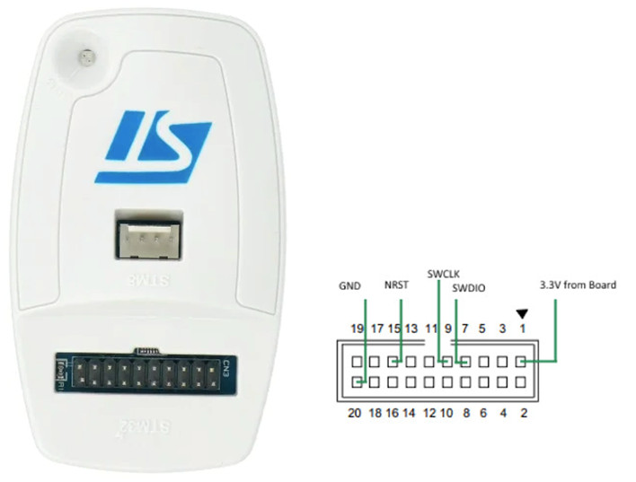

Este programa se ha compilado con la versión 4.1.1 del gestor de placas RUI3 para Arduino.

Para grabarlo en el nodo TTNMAD_DOOR seguir estos pasos:

* Programar con STM32Programmer el bootloader de RUI3 (hay 2 versiones del RAK3172, una que termina en T y es más reciente, y otra que no contiene la T denominada Evaluation Board; cada una requiere un bootloader diferente) para que, al arrancar, el nodo derive la ejecución a la posición 0x08006000. Véase https://docs.rakwireless.com/product-categories/wisduo/rak3172-module/quickstart/#upgrade-the-firmware. Se recomienda descargar en formato HEX (en lugar de en formato BIN) porque este formato incluye la información sobre las posiciones de memoria. Por ejemplo, (TI) es la versión con TCXO y conector IPEX, mientras que (I) es la versión sin TCXO con IPEX.
* Compilar el programa con Arduino IDE
* Ejecutar el comando Sketch>Exportar binario compilado para generar el firmware.
* Ejecutar el comando Sketch>Mostrar carpeta de sketch para abrir la carpeta en la que se ha generado el firmware. Acceder a la subcarpeta build y localizar el archivo con extensión .bin.
* Utilizar STM32Programmer y un ST-LINK para grabar el programa BIN a partir de la dirección 0x08006000

El consumo en estado dormido es aproximadamente 8uA a 3V para la versión sin TCXO y 10uA a 3V para la versión con TCXO.

